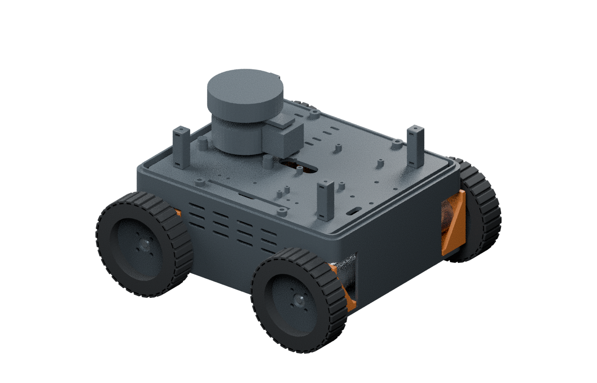

# FIELD4: four-wheel robot prototype

FIELD4 is an experimental, four-wheel skid-steer rover project with printable mechanical parts, a proposed Raspberry Pi 4/Pico hardware architecture, and reusable simulation/perception software.

*Illustrative CAD rendering of the incomplete public mechanical subset. The C02 lid is omitted. Sensor and purchased-component shapes are simplified; the image does not establish real-world fit.*

**This is an uncommissioned prototype. It is not a ready-to-power robot, finished wiring design, certified safety system, or ready-to-run Raspberry Pi firmware.**

## Start here

1. Read [current build status](docs/CURRENT_BUILD.md) and [safety and validation limits](docs/SAFETY_AND_LIMITS.md).
2. Use the [public beginner manual](docs/manual/) for power-off mechanical preparation.
3. Start with the small [fit coupons](cad/stl/coupons/), then select the [current CAD parts](cad/README.md).
4. Review the [hardware architecture proposal](docs/hardware/architecture_proposal.txt) and its open engineering questions before considering any electrical build.
5. See [software scope and requirements](software/house-lab/README.md) before using the experimental source subset.

## Design basis

- Raspberry Pi 4 for camera, LiDAR, IMU, perception and navigation
- Original Raspberry Pi Pico proposed for four motor-control/encoder channels over USB
- Arducam IMX708/B0309 camera, RPLIDAR A1M8 LiDAR and WT901 TTL IMU
- Four DFRobot FIT0185 encoder gearmotors
- Four Pololu DRV8874 #4035 motor-driver carriers, one per motor
- Four goBILDA 96 mm Hogback wheels with Sonic 6 mm hubs
- Current mechanical pair: C02 recessed A1M8 lid and C04 rearranged shelf, retaining B01 tub, B05 pillars and B09 switch blank

Component names identify the design basis. Verify actual revisions, dimensions and electrical characteristics. They do not establish physical fit or electrical compatibility.

## Repository contents

- `cad/`: reviewed printable geometry, an editable mechanical subset, mesh audit and historical generation scripts. The current C02 lid and T10 aperture coupon are withheld pending reference-model redistribution clarification.
- `docs/manual/`: public mechanical guide, editable authoring source and regenerated illustrations
- `docs/hardware/`: original engineering diagrams and sanitized technical proposal
- `software/house-lab/`: privacy-reviewed reusable v07.3 source subset; see its README for omitted scene-specific material and external requirements
- `resources/`: manufacturer links and third-party provenance notes
- `docs/history/`: privacy-edited v0.5 planning contracts and earlier Rev B visual references, retained as historical context

See [artifact coverage](docs/ARTIFACT_COVERAGE.md) for what this public edition retains and omits.

## Validation status

The 23 included STL files pass a binary-file/edge/degeneracy/positive-volume audit. This does not prove slicer success, strength, clearance on real parts, thermal behavior, vibration resistance or electrical safety. The public sensor display is a deliberately simplified original proxy, not the manufacturer's CAD or a collision/fit reference. The public CAD is incomplete: C02, T10 and the exact-reference-derived aperture profile are not distributed.

The software remains experimental. Sustained people-following, complete room-navigation success, native Windows acceptance and Raspberry Pi portability have not been established by this public edition.

## Licensing

No project-wide reuse license has been selected. See [licensing and third-party resources](resources/LICENSING.md). Linked manufacturer documents and external software remain subject to their owners' terms.
